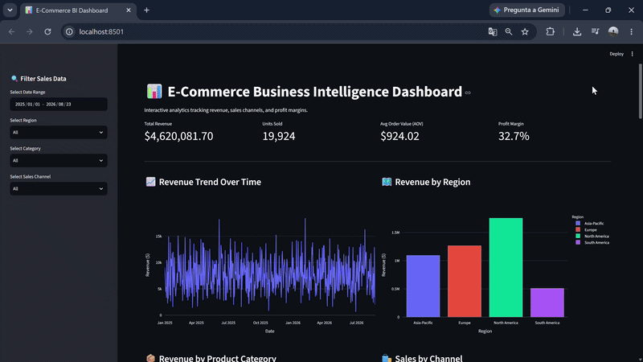

# 📊 E-Commerce & Global Sales Business Intelligence Dashboard

A professional-grade, interactive Business Intelligence application built with **Python**, **Streamlit**, and **Plotly** designed to track e-commerce transactional data, revenue performance, and category trends.

[](TU_ENLACE_DE_STREAMLIT_AQUI)



---

## 🚀 Features
- **Dynamic Global Filtering:** Filter sales data interactively by Date Range, Product Category, and Sales Region.
- **Financial KPIs & Metrics:** Real-time calculation of Total Revenue, Units Sold, Average Order Value (AOV), and Total Transactions.
- **Advanced Interactive Visualizations:**
  - Historical Monthly Revenue Trend analysis.
  - Top Performing Product Categories ranking.
  - Global Regional Sales Distribution (Donut Chart).
  - Recent Transactions Data Grid.
- **Dark Mode Corporate UI:** Polished layout built specifically for professional data presentation.

---

## 🛠️ Technology Stack
- **Python 3.10+**
- **Streamlit** (Interactive Web Framework)
- **Pandas & NumPy** (Data Manipulation & Analytics)
- **Plotly Express** (Interactive Data Visualizations)

---

## ⚙️ Installation & Setup Guide

Follow these steps to run the project locally on your machine:

1. **Clone the repository:**
   ```bash
   git clone [https://github.com/crissnyx/ecommerce-sales-bi-dashboard.git](https://github.com/crissnyx/ecommerce-sales-bi-dashboard.git)
   cd ecommerce-sales-bi-dashboard